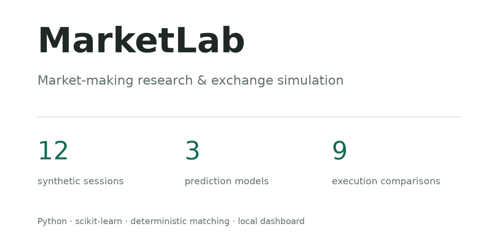
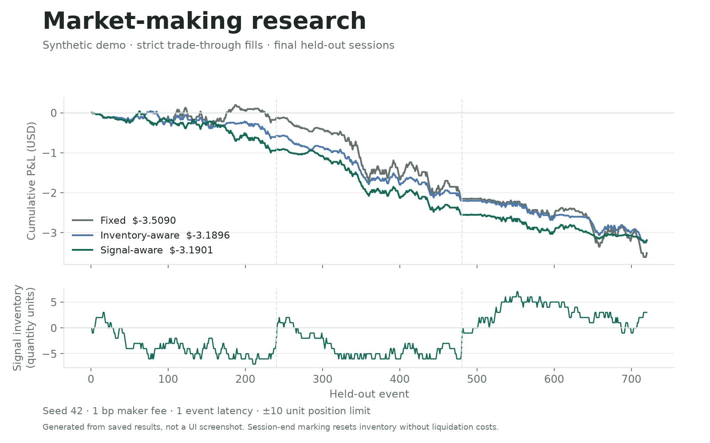

# MarketLab

<!-- project-navigation:start -->
[Architecture](docs/ARCHITECTURE.md) · [Design choices](docs/DECISIONS.md) · [Portfolio](docs/PORTFOLIO.md)
<!-- project-navigation:end -->

Market-making research and a deterministic exchange simulator, with a local dashboard for inspecting both.

[Portfolio case study](docs/PORTFOLIO.md) · [Research findings](docs/demo/findings.md) · [Architecture](docs/ARCHITECTURE.md) · [Run checks](https://github.com/victorhuii/market-research-lab/actions)



## The question

Can order-book information improve short-term forecasts, and do better forecasts translate into better simulated execution? MarketLab keeps those questions separate: a research pipeline evaluates signals, a replay engine tests quoting assumptions, and an exchange sandbox demonstrates matching and recovery.

**The demo uses synthetic data. Its results demonstrate the system, not real market profitability.** Normalized CSV import is supported. No API keys, paid data feeds or brokerage accounts are needed to run it.

## What it does

- Compares majority, imbalance-rule and logistic-regression forecasts with chronological session splits, training-only preprocessing, class metrics and calibration.
- Evaluates fixed, inventory-aware and signal-aware quotes under three fill assumptions, including fees, event latency and position limits.
- Matches integer-tick limit and IOC orders using price-time priority, with partial fills, cancellations and participant balances.
- Persists exchange commands in an fsync-backed journal, deduplicates retries and recovers from a snapshot plus replay.
- Provides a plain browser interface for replay, CSV import, exports, simulated participant flow and experiment history.

## Demo



*Generated from saved experiment results; not a browser screenshot. All three strategies lose after fees under the default strict-through assumption.*

[Execution sensitivity image](docs/assets/execution-sensitivity.png) · [Matching-engine trace](docs/assets/matching-engine-demo.png) · [Complete portfolio copy and image captions](docs/PORTFOLIO.md)

## Measured evidence

| Check | Recorded result |
| --- | --- |
| Research dataset | 2,880 synthetic snapshots across 12 sessions; 675 labeled final-test examples |
| Prediction comparison | Macro F1: majority 0.1864; imbalance rule 0.3830; logistic regression 0.3282 |
| Probability quality | Log loss: majority 1.0541; imbalance rule 1.3319; logistic regression 1.0429 |
| Execution sensitivity | Eight of nine default strategy/fill comparisons lose after fees |
| Matching correctness | Independent reference comparison, quantity/cash conservation, FIFO and recovery checks |
| Automated verification | 17 Python tests and 3 Node frontend checks passed locally |

The fixed imbalance rule has the highest F1 in this seeded demo; logistic regression has the lowest log loss. Neither result establishes real-world trading value. Full outputs, class-level results and per-session strategy outcomes are in [research.json](docs/demo/research.json).

### Matching benchmark

| Processing path | Commands / second | p50 | p95 | p99 |
| --- | ---: | ---: | ---: | ---: |
| In-memory matching core | 124,425 | 5.88 µs | 12.71 µs | 18.04 µs |
| Durable wrapper + fsync | 153 | 6.18 ms | 12.04 ms | 13.00 ms |

One recorded run: 2,000 commands, four seeded participants, 867 trades and at most 21 resting orders on macOS 15.7.3 / arm64 / Python 3.14.2. Timings exclude networking and participant-stream generation. The durable wrapper copies retained history before committing; it favors clear state transitions over speed. These are local measurements on a small book, not production latency claims. See the [complete workload and measurements](docs/benchmark.json).

## Quick start

Python 3.14 and Node 24 were used for verification. The server and research pipeline need Python; Node is only used to check frontend syntax. macOS and Linux are supported (the server uses a POSIX file lock).

```sh
git clone https://github.com/victorhuii/market-research-lab.git
cd market-research-lab
python3 -m venv .venv
source .venv/bin/activate
python -m pip install -r requirements.txt
python -m marketlab.server
```

Open **http://127.0.0.1:8765**. Stop with Ctrl+C. A different port or data directory can be selected with `--port 8766 --data runtime/another-session`.

The UI has three views:

- **Research:** model comparisons, equity replay, displayed depth, next-price probabilities, fee/latency/inventory controls, execution sensitivity, CSV import and downloadable results/findings.
- **Exchange:** submit/cancel limit or IOC orders, generate 100 commands from simulated participants, inspect trades and balances, save a snapshot, and verify recovery.
- **Experiments:** the last 30 research runs with settings, data fingerprint and outcomes. Full records remain in `runtime/experiments.jsonl`.

The server binds only to loopback. It rejects cross-origin writes and unexpected hosts. No uploaded data leaves the computer. Exchange commands survive restarts; research opens on the synthetic demo each time. The last imported CSV remains at `runtime/import.csv` and can be imported again. Keep one server per data directory; a file lock enforces this.

## Reproduce the evidence

```sh
python -m unittest discover -s tests -v
node --check web/app.js
node --test tests/frontend.test.cjs
python -m marketlab.research --output runtime/research
python -m marketlab.benchmark
```

Use your own normalized data:

```sh
python -m marketlab.research --csv /path/to/snapshots.csv --output runtime/import-study
```

See the [CSV contract](docs/DATA.md), [architecture and protocol](docs/ARCHITECTURE.md), [project scope](PROJECT_SCOPE.md), [generated findings](docs/demo/findings.md), and [measured benchmark](docs/benchmark.json). The full default-run results are in [research.json](docs/demo/research.json).

## What the evidence establishes

The research compares a majority baseline, a fixed imbalance rule and regularized multinomial logistic regression. Entire sessions are split 60% / 20% / remainder, chronologically. Labels stay within sessions; overlapping label horizons are purged at boundaries. Scaling fits only training rows. C is selected on validation loss; the final test is scored afterward. Rerunning and tuning on that same test set makes subsequent work exploratory.

Fixed, inventory-aware and signal-aware quotes are evaluated under touch, strict trade-through and displayed-depth queue-proxy assumptions. Fees, event latency and position limits apply consistently. Prediction and strategy results remain separate. P&L is marked to midpoint, with per-session inventory reset and no liquidation cost; exact queue position and own market impact are unobserved.

Synthetic order-book pressure was deliberately made persistent. Predictive performance here demonstrates the pipeline, not a financial discovery. Real market conclusions require independently obtained sessions and a fresh holdout. No annualized returns, production HFT claims or recruiter endorsements are made.

The engine uses integer arithmetic, price-time priority and execution at the resting price. Tests include an independent list-based reference, conservation checks, journal corruption, torn writes, unacknowledged persisted commands and snapshot replay. Python favors inspectability; the durable wrapper copies command history before committing and is deliberately slower than the matching core. Benchmark results state the workload and separate both paths.

## Two-minute demo

1. In Research, inspect the synthetic source label, test metrics and default strict-through results.
2. Switch fill assumptions and compare the sensitivity table. Move the replay slider or press Play to inspect book depth, forecasts and inventory over time.
3. Change fees or latency, run again, and inspect the new entry in Experiments. Export findings or JSON.
4. In Exchange, run the simulated flow, inspect partial fills and balances, then save a snapshot and recover. The confirmation compares book, trades and balances.
5. Download the demo CSV to inspect the exact input format. Import your own chronological sessions to repeat the study.

## Project notes

`AGENTS.md` and `docs/STATUS.md` are the compact continuation context. The raw conversation export and personal source documents are intentionally excluded. Feature commits use simple lowercase messages and are pushed to the configured GitHub origin.


## Portfolio assets

[docs/PORTFOLIO.md](docs/PORTFOLIO.md) contains a project-card summary, full case study, resume bullets, technical details, captions, alt text, image URLs and a demo walkthrough. PNG and editable SVG assets are in [docs/assets/](docs/assets/). The images are generated result charts and an engine trace; UI screenshots remain unavailable because browser capture could not be verified.

To regenerate the figures from committed evidence:

```sh
python -m pip install -r requirements-assets.txt
MPLCONFIGDIR=/tmp/marketlab-matplotlib python scripts/portfolio_assets.py
```

Figure generation is optional and does not add dependencies to the application.
