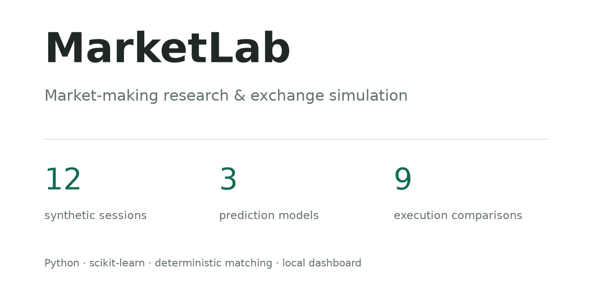
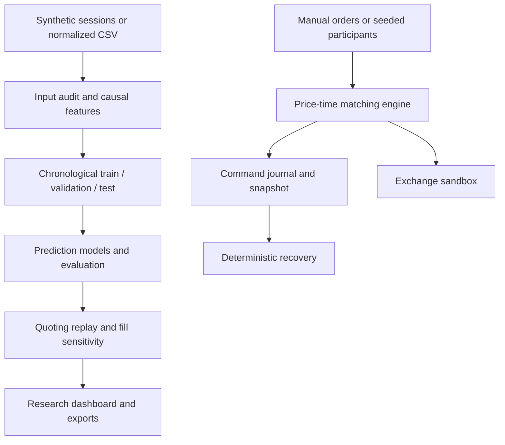
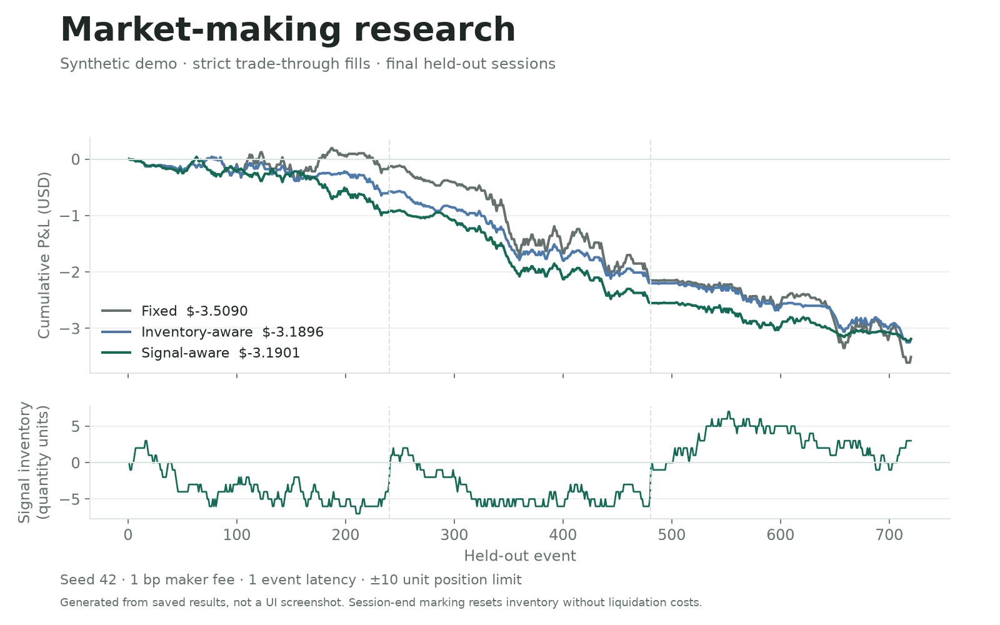
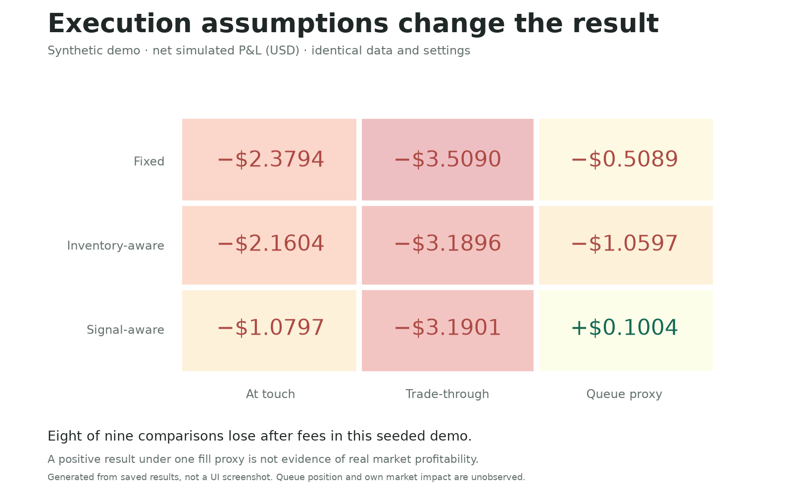
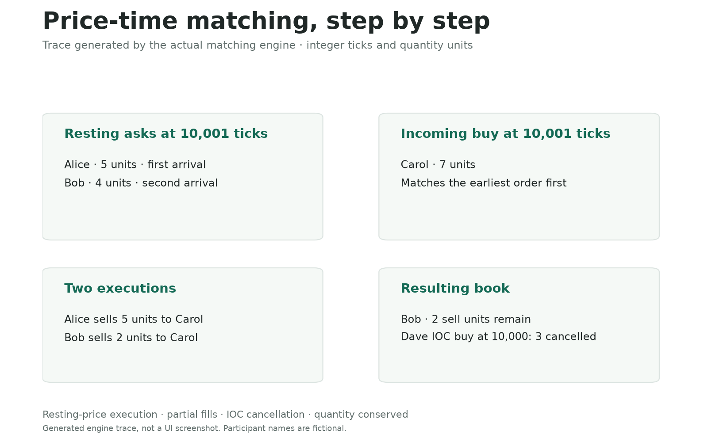

# MarketLab



## Project card

**Title:** MarketLab  
**Subtitle:** Market-making research and exchange simulation.  
**Short description:** A local workbench for evaluating order-book signals, comparing simulated quoting strategies, and exploring a deterministic exchange matching engine.  
**Tags:** Quantitative research, market microstructure, Python, systems engineering.  
**Primary link:** [View source on GitHub](https://github.com/victorhuii/market-research-lab).  
**Demo:** Runs locally; no hosted application is currently published.  
**Ownership:** Personal project, implemented with Codex assistance.

## Case study

### Why I built it

I wanted to explore both sides of a trading system: how a researcher evaluates a signal, and how an exchange processes orders. A forecast can look useful while a strategy loses after fees or fills. MarketLab makes that distinction visible and gives each part its own correctness checks.

### What I built

MarketLab combines a reproducible research pipeline, a quoting-strategy replay engine, and a separate exchange sandbox in one local application. The browser interface lets me inspect forecasts and inventory event by event, change execution assumptions, import normalized CSV data, and export a complete experiment report.

The research pipeline calculates causal order-book features and predicts whether the midpoint will move down, stay unchanged, or move up. It compares a majority baseline, a fixed imbalance rule, and regularized logistic regression. Entire sessions are held out chronologically, preprocessing is fitted on training data, and regularization is selected using validation loss.

The strategy replay compares fixed, inventory-aware, and signal-aware quotes. Each runs under touch, strict trade-through, and displayed-depth queue-proxy fills. Maker fees, event latency, and position limits apply consistently. The results report P&L, drawdown, exposure, turnover, fill rate, and per-session outcomes.

The exchange sandbox implements price-time matching with integer prices and quantities. It handles limit and IOC orders, partial fills, cancellations, duplicate requests, and participant balances. Accepted commands are journaled and fsynced before acknowledgment. A saved snapshot and subsequent journal records reproduce the exchange state after restart.

### How the application is organized



The research replay and exchange engine are independent. The sandbox tests exchange mechanics; it does not validate the historical fill model.

### Decisions and tradeoffs

| Decision | Reason | Cost or limit |
| --- | --- | --- |
| Python for research and matching | Keeps the behavior readable and easy to compare with reference tests | Not a production HFT implementation |
| Integer ticks and quantities | Makes matching and conservation exact | External feeds need explicit unit conversion |
| Session-based evaluation | Keeps training and test periods separate and avoids shuffled time-series rows | A small synthetic sample cannot establish robustness |
| Three fill assumptions | Shows how execution assumptions change conclusions | Aggregated depth cannot reconstruct exact queue position |
| Fsync before acknowledgment | Makes the durability contract explicit and testable | Durable processing is much slower than the matching core |
| Plain HTML, CSS and JavaScript | Keeps the UI small and removes a frontend build step | Fewer framework conveniences |
| Local-only storage | Avoids accounts, credentials and external runtime services | No shared hosted workspace |

### What the results showed

The committed seed-42 demo contains **2,880 snapshots across 12 synthetic sessions**. Seven sessions train the models, two select regularization, and three form the final test. The final test has **675 labeled examples** after warmup and horizon exclusions.

| Predictor | Macro F1 ↑ | Log loss ↓ | Brier score ↓ |
| --- | ---: | ---: | ---: |
| Majority baseline | 0.1864 | 1.0541 | 0.6398 |
| Imbalance rule | 0.3830 | 1.3319 | 0.7926 |
| Logistic regression | 0.3282 | 1.0429 | 0.6302 |

The simple imbalance rule achieves the highest F1. Logistic regression produces the lowest log loss and Brier score. That difference matters: classification quality and probability quality answer different questions.

Eight of nine strategy/fill comparisons lose after fees. For signal-aware quotes, net simulated P&L changes from **−$1.0797 at touch** to **−$3.1901 under strict trade-through** and **+$0.1004 under the queue proxy**. Fewer fills can avoid adverse selection, so a more restrictive proxy does not necessarily produce lower P&L.

These are results from synthetic dynamics that deliberately include persistent order-book pressure. They show the evaluation workflow, not a discovered market edge. The report preserves losses and simpler-model wins rather than treating profitability as a completion criterion.

### Systems evidence

The matching benchmark processes **2,000 commands from four seeded participants**, producing **867 trades** with at most **21 resting orders**. On the recorded macOS 15.7.3 / arm64 / Python 3.14.2 run:

| Processing path | Throughput | p50 service time | p95 | p99 |
| --- | ---: | ---: | ---: | ---: |
| In-memory matching core | 124,425 commands/s | 5.88 µs | 12.71 µs | 18.04 µs |
| Durable wrapper + fsync | 153 commands/s | 6.18 ms | 12.04 ms | 13.00 ms |

The workload mixes limit orders, IOC orders and cancellations. Generation and networking are excluded. The durable wrapper copies retained history before applying each command, so its cost grows with history. These measurements describe a small local workload; they are not exchange-scale or end-to-end latency claims.

**Verification:** 17 Python tests and three Node frontend checks passed locally. Checks cover an independent matching reference, FIFO and price priority, partial fills, cash/quantity conservation, request retries, corrupted journals, torn writes, snapshot recovery, feature causality, chronological splits, fill arithmetic, CSV validation, HTTP integration, and safe frontend text rendering. A GitHub Actions workflow is included; its current remote status is available on the repository Actions page. Browser layout verification remains incomplete because browser capture was unavailable.

### What I would improve next

The next research step is a licensed real dataset with independent sessions and a fresh holdout. The next systems step is profiling the durable state-copy path and evaluating a more efficient journal design against the existing recovery tests. Actual browser screenshots and responsive layout QA are also needed before calling the UI visually verified.

Other boundaries remain explicit: no live order execution, no own-market-impact model, no exact queue reconstruction, and no liquidation costs at session-end midpoint marking. Repeated tuning on the same test sessions is exploratory.

## Demo gallery

These images are **generated charts and an engine trace**, not UI screenshots. Charts read the committed experiment output. The trace runs the actual matching engine with fictional participants.

### Research replay



**Caption:** Held-out synthetic P&L and inventory under strict trade-through fills. All three default quoting strategies lose after fees. Dashed lines mark session boundaries.  
**Best use:** Main case-study image.  
**Size:** 1600 × 1000 PNG; editable SVG also included.

### Execution sensitivity



**Caption:** The same data produces materially different simulated outcomes under different fill assumptions. Eight of nine comparisons lose after fees.  
**Best use:** Results section or project carousel.  
**Size:** 1600 × 1000 PNG; editable SVG also included.

### Matching-engine trace



**Caption:** A buy order fills the earliest resting sell first, partially fills the next order, and leaves two units in the book. A lower-priced IOC buy cancels its unfilled remainder.  
**Best use:** Systems section or interview walkthrough.  
**Size:** 1600 × 1000 PNG; editable SVG also included.

### Cover / social card

**File:** `assets/portfolio-cover.png` (1280 × 640).  
**Alt text:** MarketLab project cover showing twelve synthetic sessions, three prediction models, and nine execution comparisons.  
**Best use:** Portfolio project card or social preview.  
**GitHub social preview:** The prepared image can be uploaded in the repository's social-preview settings; committing it does not automatically set that field.

## Image files and website reuse

Copy this Markdown file together with the `assets/` directory to keep its relative image links working. If your site stores images in a public directory, copy the PNGs there and update the Markdown paths. Frontmatter above is starter metadata; adapt the keys to your site's content schema.

| Asset | PNG URL for an external portfolio |
| --- | --- |
| Cover | https://raw.githubusercontent.com/victorhuii/market-research-lab/main/docs/assets/portfolio-cover.png |
| Research replay | https://raw.githubusercontent.com/victorhuii/market-research-lab/main/docs/assets/research-demo.png |
| Execution sensitivity | https://raw.githubusercontent.com/victorhuii/market-research-lab/main/docs/assets/execution-sensitivity.png |
| Matching trace | https://raw.githubusercontent.com/victorhuii/market-research-lab/main/docs/assets/matching-engine-demo.png |

Use locally copied images for a self-contained website. These `main` URLs track future changes; use a commit-pinned URL when you need immutable evidence. SVG versions have the same filenames with `.svg` extensions.

## Resume-ready bullets

- Built a Python order-book research pipeline comparing three predictors across 12 synthetic sessions with chronological validation, training-only preprocessing, calibration metrics, and reproducible reports.
- Evaluated nine quoting-strategy/fill combinations with maker fees, latency, and position limits; exposed how execution assumptions changed simulated P&L, including losing strategies.
- Implemented a deterministic price-time matching engine with partial fills, IOC orders, cancellations, fsync-backed journaling, request deduplication, and snapshot recovery; verified behavior with independent reference and failure-injection tests.

If using the benchmark in a resume, keep the qualification attached: “Measured 124k commands/s in the in-memory core and 153 commands/s with the fsync-backed wrapper on a 2,000-command local workload.” Do not describe the core number as durable or networked throughput.

## Demo walkthrough

1. Open Research and identify the synthetic dataset and held-out sessions.
2. Compare F1 and log loss across the three models; explain why their rankings differ.
3. Switch the fill model and inspect the strategy sensitivity table.
4. Replay a session to connect forecasts, inventory, and P&L.
5. In Exchange, run 100 simulated commands, inspect trades and remaining orders, save a snapshot, and recover.
6. Export findings and show the experiment log with settings and the input fingerprint.

## Run and reproduce

```sh
git clone https://github.com/victorhuii/market-research-lab.git
cd market-research-lab
python3 -m venv .venv
source .venv/bin/activate
python -m pip install -r requirements.txt
python -m marketlab.server
```

Open `http://127.0.0.1:8765`. Python 3.14 was used for verification; macOS/Linux are supported. Application runtime requires no AI services or external credentials. See the [README](../README.md) for checks and research CLI commands.

## Evidence and implementation links

- [Source repository](https://github.com/victorhuii/market-research-lab)
- [Generated research findings](demo/findings.md)
- [Complete research output](demo/research.json)
- [Benchmark workload and measurements](benchmark.json)
- [Architecture, durability and API contract](ARCHITECTURE.md)
- [CSV data contract](DATA.md)
- [Original release scope](../PROJECT_SCOPE.md)
- [Asset generator](../scripts/portfolio_assets.py)
